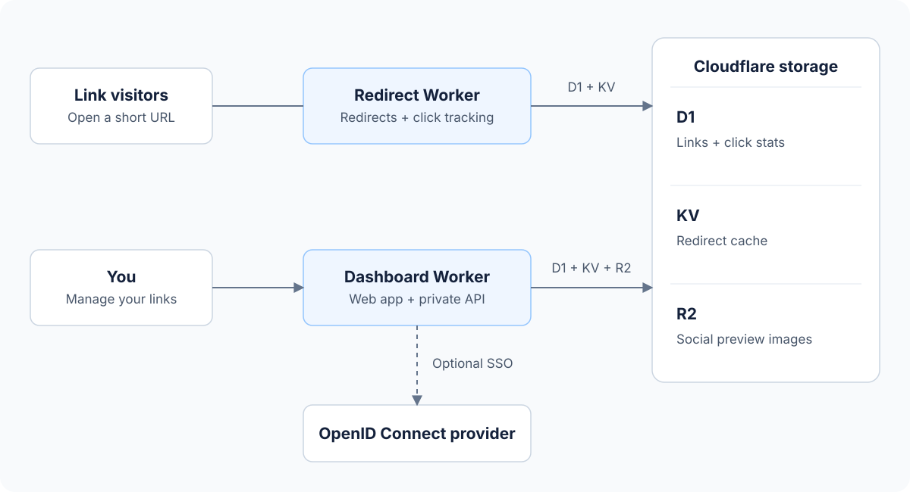

# Architecture

The application has two independently deployed Cloudflare Workers. They share storage, while public redirects and dashboard authentication stay separate.

## Public redirects

The [redirect Worker](packages/redirect/src/index.ts) resolves a custom slug, a short encoded ID, or an alternate “loooogan” URL to the same link record. KV caches link records and custom-slug lookups; D1 remains the persistent store.

Visitors receive an HTTP redirect. When social previews are enabled, recognized crawlers receive the link's preview metadata. Click recording runs in the background.

The alternate URL uses visually similar Unicode “o” characters. Copy it exactly; replacing characters can produce a different ID. The [codecs](packages/shared/src) own the encoding rules.

## Private dashboard

The [dashboard Worker](packages/dashboard/src/index.ts) serves the Vue application, its private API and authentication routes. It manages links in D1, updates the KV cache, and stores uploaded preview images in R2. R2 images are served from a public image domain.

API-token sign-in is available by default. OpenID Connect can be enabled independently; provider tokens stay on the server. Each deployment owns its credentials and sessions. See [authentication](docs/authentication.md) for setup, revocation and recovery behavior.

Public redirects and preview images do not require a dashboard session. Link management, sharing helpers and QR generation require authentication.

## Data and privacy

D1 stores links, click events and optional authentication state. Click events include time, referrer, country, user agent and an IP hash rather than the raw IP address. Keep the database durable; cache contents are replaceable.

The dashboard owns its UI assets and builds independently. Light/dark preference stays in the browser. Deployment values and credentials belong in private configuration, never in frontend assets or committed source.

Use [the deployment guide](docs/deployment.md) for setup and [development](docs/development.md) for checks and UI asset maintenance. Database schema and route details live in the migrations and source code.
