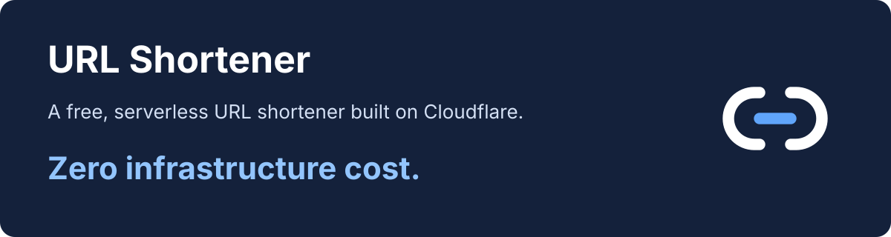
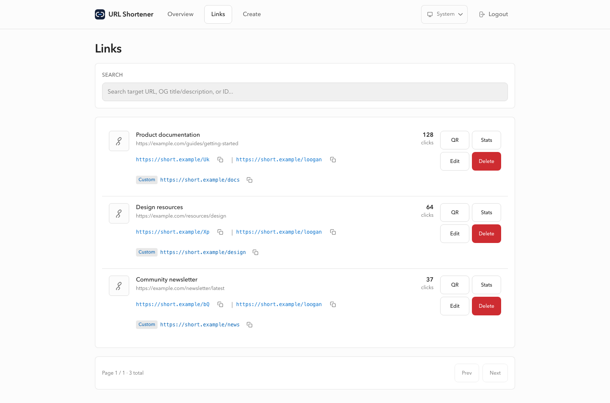
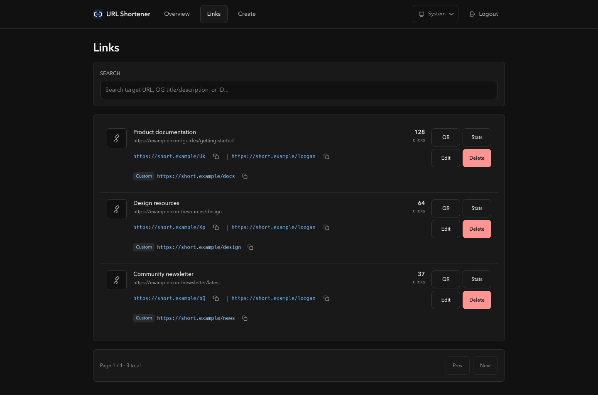
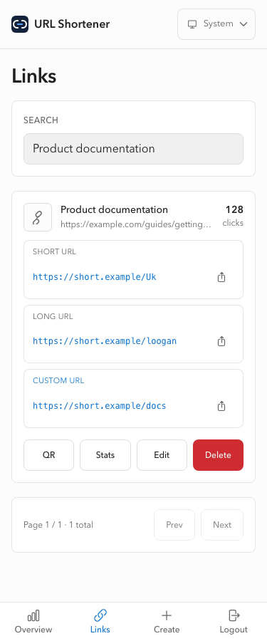
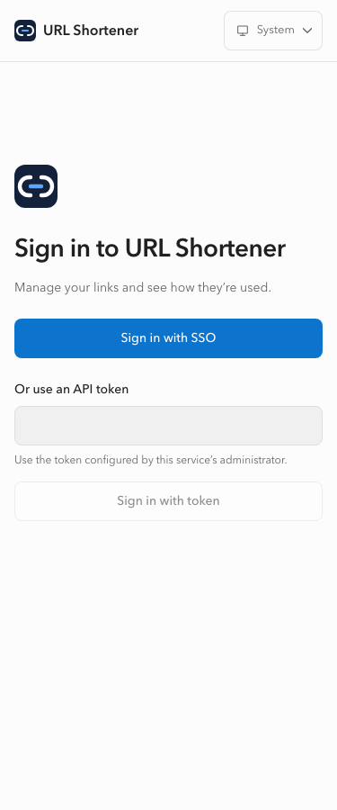
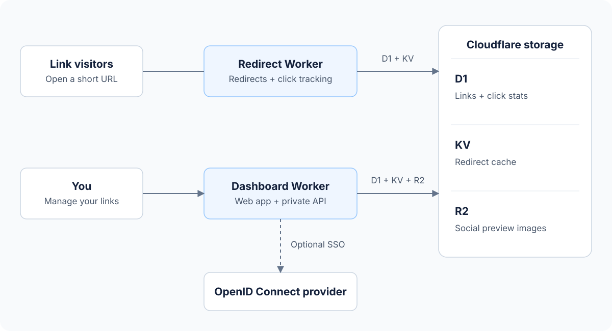

# URL Shortener

> A free, serverless URL shortener built on Cloudflare. Zero infrastructure cost.

Turn long URLs into short links on your own domain. Manage them in a dashboard, customize their social previews, and see where clicks come from.

## What you can do

- **Create and share links** — get a short URL, a custom slug such as `/docs`, and a QR code. Every link also gets an alternate “loooogan” URL.
- **Control social previews** — choose the title, description and image shown when a link is shared.
- **See click stats** — explore clicks by day, referrer and country.
- **Use the dashboard anywhere** — desktop and mobile layouts, with light and dark themes.
- **Choose how to sign in** — use an API token, or optionally connect an OpenID Connect provider such as Pocket ID.

## A look inside

Dark theme, mobile layout and sign-in

 

Screenshots use example data.

## How it works

Two Workers handle public redirects and the private dashboard separately. D1 stores links and clicks, KV caches redirects, and R2 stores preview images. No server to manage. [Architecture details](ARCHITECTURE.md).

## Get started

1. Follow the [deployment guide](docs/deployment.md) to set up your domain and Cloudflare resources.
2. Open `https://your-domain.com/dashboard/` and sign in with your API token, or SSO if enabled.
3. Create a link, copy its URL or QR code, and share it. Add a custom slug or social preview when needed.

Optional: [connect an OpenID Connect provider](docs/authentication.md). For contributing and local checks, see [development](docs/development.md).

## License

[MIT](LICENSE)
